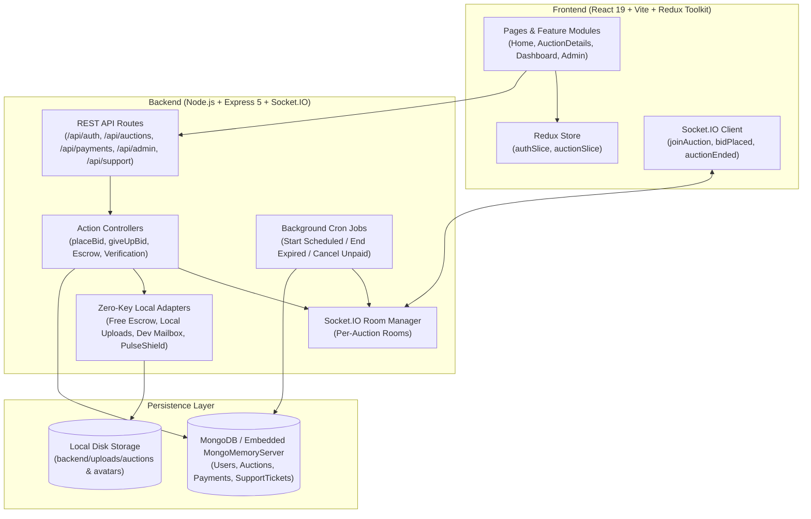

# PulseVault (AuctionPulse) — Real-Time Soft-Close & Escrow Auction Exchange

**PulseVault** is a full-stack, real-time online auction platform built with a turn-based soft-close bidding engine, WebSocket room synchronization, automated settlement lifecycles, and a zero-dependency local escrow and media architecture.

---

## Problem Statement

Traditional online auction platforms suffer from three persistent problems:

1. **Last-Second Bid Sniping**: Fixed-deadline auctions reward automated scripts and last-millisecond bids rather than genuine price discovery, frustrating human bidders who have no time to respond.
2. **Post-Auction Settlement & Trust Friction**: Unverified listings, opaque winner settlement flows, and lack of structured delivery/dispute tracking leave both buyers and sellers exposed to fraud or non-payment.
3. **High Barrier to Local Evaluation & Prototyping**: Most full-stack auction systems require paid or external third-party credentials (Stripe, Cloudinary, Cloudflare Turnstile, SendGrid/Brevo, and external MongoDB clusters) before a developer can even launch a single auction locally.

---

## Target Users

- **Collectors & Enthusiast Bidders**: Users competing for high-demand items (horology, rare collectibles, audio gear, studio hardware, and fine art) who want fair, transparent, real-time bidding without bot sniping.
- **Individual & Boutique Sellers**: Creators and curators who need a structured marketplace to list items, undergo verification, track live bidding momentum, and receive automated escrow payouts upon confirmed delivery.
- **Marketplace Administrators & Moderators**: Operations teams who verify submitted auction lots, monitor platform revenue/commissions, resolve buyer-seller disputes, and manage support tickets.
- **Developers & Evaluators**: Engineers looking for a self-contained, zero-paid-API real-time auction reference architecture that runs out of the box on `localhost`.

---

## Solution

PulseVault solves these challenges through a **synchronized real-time bidding floor** combined with **end-to-end transaction governance**:

- **Turn-Based Soft-Close Anti-Sniping Engine**: Once bidding begins, a 25-second turn clock governs the floor. Any bid placed within the final 12 seconds automatically extends the clock by +15 seconds, ensuring every active participant gets a fair chance to counter-bid until all rivals either time out or explicitly fold ("Pass / Fold").
- **Escrow-Backed Settlement & Verification Pipeline**: Listings pass through administrative verification before going live. When the hammer falls, the winning bidder settles via an integrated Escrow Checkout Engine (retaining a 5% platform fee and allocating 95% to seller payout), followed by shipment tracking, buyer delivery confirmation, and a 7-day dispute window.
- **Zero-Paid-Key Local Infrastructure**: PulseVault includes built-in local adapters for its database (`MongoMemoryServer` fallback with auto-seeded demo data), escrow checkout (`FREE_ESCROW_MODE`), local disk media storage (`LOCAL_MEDIA_STORAGE`), human verification (`PulseShield`), and an in-memory developer mailbox (`LOCAL_EMAIL_INBOX`), while remaining fully compatible with production providers via environment flags.

---

## Key Features

### Real-Time Bidding Room
- **Live WebSocket Floor (`Socket.IO`)**: Instantaneous broadcast of new bids, price increments, turn deadlines, active participant counts, and auction completion across all connected clients.
- **Soft-Close Anti-Sniping Timer**: 25-second turn countdown per bid with automatic +15-second soft-close extension when a bid arrives inside the final 12 seconds.
- **Quick-Increment Bid Deck**: One-click increment buttons (`+$25`, `+$50`, `+$100`, `+$250`) alongside custom bid validation and minimum increment enforcement.
- **Fold / Pass Action & Instant Hammer**: Active bidders can formally exit the bidding war (`Give Up / Fold`); when only one active contender remains, the auction concludes immediately in their favor.
- **Interactive Rival Bid Simulator**: Built-in rival counter-bid simulation on the live auction page to test multi-bidder WebSocket synchronization and soft-close extensions from a single browser window.

### Marketplace & User Workflows
- **Multi-Phase Auction Discovery**: Filter and search auctions across `Ongoing (Live)`, `Upcoming (Scheduled)`, and `Completed (Hammered)` states with category filtering and pagination.
- **Seller Studio**: Create and manage listings with up to 5 product images (stored locally or via Cloudinary), starting price, minimum bid increment, and scheduled start/end windows.
- **One-Click Demo Persona Switcher**: Log in immediately as pre-seeded verified buyers/sellers or the platform administrator directly from the login screen.
- **Profile & OTP Verification**: Email OTP verification with an integrated local developer mailbox (`/api/dev/mailbox`) that auto-surfaces verification codes in local development.
- **Escrow Checkout & Order Fulfillment**: Winners complete payment through the built-in Escrow Checkout Engine, sellers submit shipping carrier/tracking details, and buyers confirm delivery or open a dispute.

### Admin Control Center
- **Listing Moderation Queue**: Approve or reject `pending_verification` auction lots before they appear on the public floor.
- **Financial & Escrow Ledger**: Track gross merchandise volume (GMV), 5% platform commission revenue, pending escrow balances, and released seller payouts.
- **Dispute & Support Ticket Management**: Review buyer disputes, inspect evidence, and update support ticket statuses with automated user notifications.

---

## Tech Stack

| Layer | Technologies |
| :--- | :--- |
| **Frontend** | React 19, Vite 6, Tailwind CSS 3, Redux Toolkit, React Router v7, Socket.IO Client, Axios, Lucide React, React Toastify |
| **Backend** | Node.js, Express 5, Socket.IO 4, Mongoose 8, JSON Web Tokens (JWT), Multer, Express Rate Limit, Node-Cron |
| **Database** | MongoDB (Local/Atlas via `MONGO_URI`) with automatic embedded `mongodb-memory-server` fallback and deterministic demo seeding |
| **Payments & Media** | Built-in Free Escrow Engine (`FREE_ESCROW_MODE`) + optional Stripe SDK; Built-in Local Disk Media Upload (`/uploads`) + optional Cloudinary |
| **Security & Mail** | Built-in `PulseShield` verification widget + optional Cloudflare Turnstile; Built-in Dev Mailbox (`/api/dev/mailbox`) + optional Brevo/Nodemailer |

---

## Architecture

PulseVault follows a modular client-server architecture with RESTful APIs for state mutations, a dedicated WebSocket layer for low-latency room broadcasts, and background cron workers for auction lifecycle transitions.



### Major Components
1. **HTTP & WebSocket Bootstrap (`backend/server.js`, `backend/bootstrap/`, `backend/sockets/`)**: Initializes Express middleware, CORS policies, static `/uploads` serving, REST route mounting, and the `Socket.IO` server managing per-auction rooms (`joinAuction` / `leaveAuction`).
2. **Domain Controllers (`backend/controllers/`)**: Organized by domain (`auction`, `auth`, `payment`, `admin`, `support`) with single-responsibility action handlers (e.g., `placeBid.js`, `giveUpBid.js`, `createCheckoutSession.js`, `confirmCheckoutSuccess.js`).
3. **Lifecycle Background Workers (`backend/jobs/registerBackgroundJobs.js`)**: Periodic jobs that transition `future` auctions to `ongoing` when their start time arrives, close `ongoing` auctions when turn timers or end times expire, and handle unpaid winner timeouts.
4. **Database & Auto-Seeder (`backend/config/db.js`, `backend/config/seedDemoData.js`)**: Connects to `MONGO_URI` and automatically falls back to an embedded `MongoMemoryServer` instance if no local MongoDB daemon is running, seeding verified demo accounts, live/upcoming/completed auctions, and support tickets.
5. **Feature-Sliced Frontend (`frontend/src/features/`, `frontend/src/pages/`)**: Encapsulates domain logic, custom hooks (`useAuctionDetails.js`, `useProfileVerificationFlow.js`), and real-time UI components (`AuctionActionsPanel.jsx`, `AuctionOverviewSection.jsx`, `AuctionHistorySection.jsx`).

---

## Local Setup

### Prerequisites
- **Node.js** `v18+` (recommended `v20+`)
- **npm** `v9+`
- *(Optional)* Local **MongoDB** instance on port `27017` — if not installed or not running, the backend automatically boots an embedded MongoDB server and seeds demo data.

### 1. Clone the Repository
```bash
git clone <repository-url>
cd AUC
```

### 2. Install Dependencies
```bash
# Install backend dependencies
npm install --prefix backend

# Install frontend dependencies
npm install --prefix frontend
```

### 3. Configure Environment Variables
Create `backend/.env` and `frontend/.env` using the templates documented in the [Environment Variables](#environment-variables) section below.

### 4. Start the Application
Open two terminals from the project root:

**Terminal 1 — Start Backend API & WebSocket Server (`http://localhost:5000`):**
```bash
npm run dev --prefix backend
```

**Terminal 2 — Start Frontend Vite Server (`http://localhost:5173`):**
```bash
npm run dev --prefix frontend
```

Open `http://localhost:5173` in your browser.

### Pre-Seeded Demo Accounts
When running with the auto-seeded database, you can sign in with one click on the `/login` page or use these credentials:

| Role | Email | Password |
| :--- | :--- | :--- |
| **Verified Buyer / Seller 1** | `alex@bidpulse.io` | `Password@123` |
| **Verified Buyer / Seller 2** | `maya@bidpulse.io` | `Password@123` |
| **Verified Buyer / Seller 3** | `liam@bidpulse.io` | `Password@123` |
| **Platform Admin** | `admin@bidpulse.io` | `Admin@1234` |

---

## Environment Variables

No paid or external API keys are required to run the project locally. Copy the configurations below into `backend/.env` and `frontend/.env`.

### Backend (`backend/.env`)

```env
# Server & Environment
NODE_ENV=development
PORT=5000
FRONTEND_URL=http://localhost:5173
BACKEND_URL=http://localhost:5000

# Database (Automatically falls back to embedded MongoMemoryServer if local MongoDB is unavailable)
MONGO_URI=mongodb://127.0.0.1:27017/auctionpulse

# Authentication & Admin Credentials
JWT_SECRET=<your-jwt-secret-string>
ADMIN_EMAIL=admin@bidpulse.io
ADMIN_PASSWORD=<your-admin-password>

# Free Built-In Local Mode Flags (No external API keys required)
FREE_ESCROW_MODE=true
LOCAL_MEDIA_STORAGE=true
LOCAL_EMAIL_INBOX=true

# Bot Verification (Uses built-in local verification when set to free-local-shield-secret)
TURNSTILE_SECRET_KEY=free-local-shield-secret

# Optional External Integrations (Leave blank for local/free mode)
STRIPE_SECRET_KEY=
STRIPE_WEBHOOK_SECRET=
CLOUDINARY_CLOUD_NAME=
CLOUDINARY_API_KEY=
CLOUDINARY_API_SECRET=
BREVO_API_KEY=
EMAIL_USER=
EMAIL_PASS=
```

### Frontend (`frontend/.env`)

```env
# Backend API & Socket Endpoints
VITE_API_URL=http://localhost:5000/api
VITE_BACKEND_URL=http://localhost:5000

# Built-In PulseShield Verification Key
VITE_TURNSTILE_SITE_KEY=free-local-shield-sitekey
```
